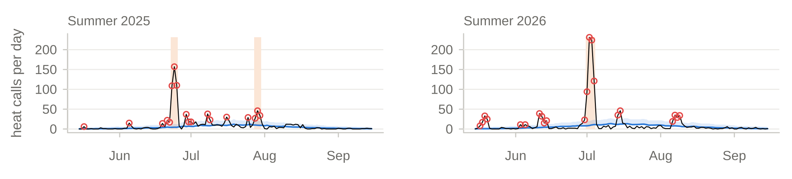

*Can paramedic data give early warning of heat's health impact, and measure the burden that heat-coded records miss?*

Hospital and mortality data show what heat did to people's health, but they arrive months after the event. Paramedic data are recorded the same day, yet they are rarely part of routine heat surveillance. This project is a proof of concept of what a public health unit could get from them, using public New York City ambulance dispatch data from 2010 to September 2026.

<!-- STATS GRID -->

  

    19/20
    heat waves flagged in 2016–2024, and 3/3 in held-out 2025–2026, all on the first day
  

  

    ~2
    alerts per summer outside heat waves
  

  

    1 in 3
    heat-associated excess calls carries a heat code
  

<!-- INTERACTIVE DASHBOARD -->

  <iframe
    src="/dashboards/ems_heat_watch/ems_heat_watch.html"
    width="100%"
    height="1000px"
    style="border: 1px solid #ddd6cc; border-radius: 4px; display: block;">
  </iframe>
  

    <a href="/dashboards/ems_heat_watch/ems_heat_watch.html" target="_blank"
       style="background: #2c3e50; color: white; padding: 10px 22px;
              border-radius: 6px; text-decoration: none; font-weight: 600;
              font-family: sans-serif; font-size: 0.85rem;">
      Open the full-screen dashboard ↗
    </a>
  

  Pick a year and a method to see daily heat-coded ambulance calls against the number expected on a normal-temperature day, with alerts and heat waves marked. Held-out years: 2025–2026.
  Source: NYC Open Data (EMS Incident Dispatch Data); NOAA (Central Park daily maximum temperature).

---

## Approach

I counted daily ambulance calls coded "heat" (about 800 a year), plus heat-related calls with other codes, chosen in advance: unconscious, altered mental status, sick, breathing difficulty, cardiac, respiratory and arrest. Temperature is the daily maximum at Central Park (NOAA).

Each day, heat-coded calls are compared with the number expected on a normal-temperature day at that time of year (a Poisson regression for season, weekday, trend and temperature, refitted weekly), and an alert is raised above the 99.5% limit. I tested this by replaying 2016–2026 day by day on past data only; 2025–2026 was held out and nothing was tuned on it. A heat wave is 3 or more days at 32.2 °C or above.

---

## Results

**Early warning.** The indicator flagged 19 of 20 heat waves in 2016–2024 and all 3 in the held-out 2025–2026 seasons, each on the first day. Outside heat waves it raised about 2 alerts per summer (1.8 in 2016–24, 2.1 in 2025–26). It does not predict heat: it confirms the health impact on the day it happens and shows its size.

I compared it with two standard aberration-detection methods from the R `surveillance` package: Farrington Flexible, used for routine communicable disease surveillance, and the CDC's EARS C1–C3.

| Method | Heat waves flagged, 2016–24 | Alerts per summer outside heat waves |
|---|---|---|
| This indicator | 19/20 | 1.8 |
| Farrington Flexible | 17/20 | 0.3 |
| EARS C1–C3 | 15–18/20 | 4.4–7.3 |

It also flagged 49% of single hot days (2016–24). These rarely get a heat warning, since warnings are issued for events of two or more days.

<figure style="margin: 2rem 0;">
  

    
  

  <figcaption>Daily heat-coded calls in the held-out summers of 2025 and 2026. Black: observed. Blue line and band: expected on a normal-temperature day, and its normal range. Red circles: alerts. Shaded: heat waves.</figcaption>
</figure>

**Hidden burden.** About 1 in 3 heat-associated excess calls carries a heat code (34%, 95% CI 26–41%, across 23 heat waves). The rest are coded as unconscious, sick, breathing, cardiac and similar. Counting heat-coded calls alone would miss about two thirds of the excess.

**Timeliness.** NYC's public release runs about 6–7 weeks behind. An internal paramedic feed would be same-day, while hospital and mortality data take months.

---

## Limits

* Dispatch codes reflect what callers and crews report, not diagnoses.
* Only 3 heat waves fall in the held-out period, and temperature comes from one weather station.
* The data are from New York City; the approach has not yet been tested in Toronto.

---

## Next step

The next step is the same approach on Toronto Paramedic Services data, using humidex and Toronto's 158 neighbourhoods. One open question is whether Toronto's dispatch system records a heat or exposure code; if not, the "other codes" approach carries the signal.

Environment and Climate Change Canada issues heat warnings 18–24 hours ahead for events of two or more days. Paramedic data would add the health side: is heat causing harm, and how much.

*Built in R (analysis scripts and a small static dashboard), using only public data. Views are my own.*
