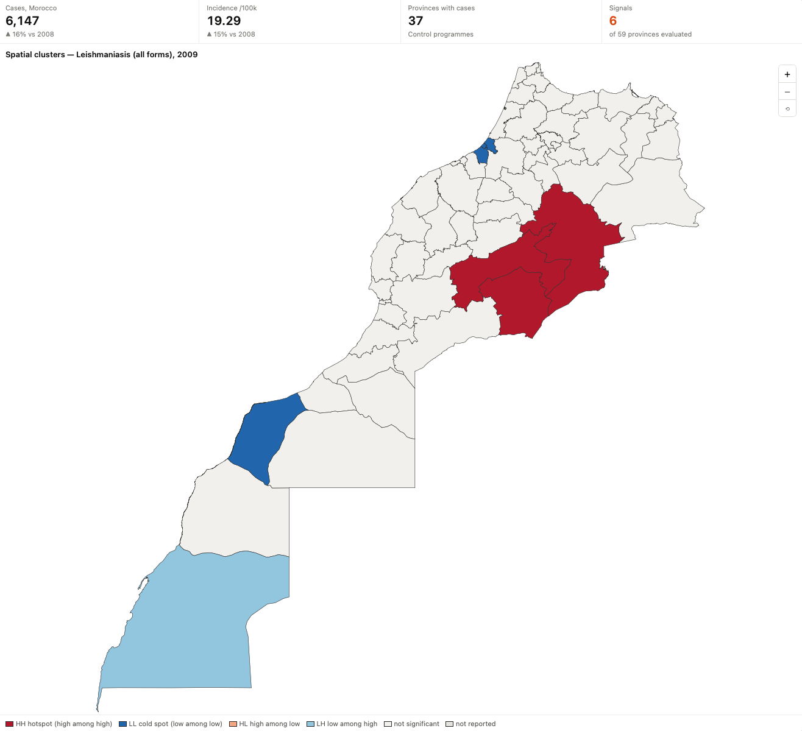

In 2019 I caught cutaneous leishmaniasis in Costa Rica. I had access to
treatment, but in many places where it is endemic it remains a neglected
disease, neglected by funding, by surveillance systems and by the tools that
exist for other diseases. My home country, Morocco, has reported its cases by
province for more than twenty years. This project started as a risk model for
leishmaniasis and grew into a surveillance tool for all 33 notifiable diseases
that Morocco reports by province.

The Ministry of Health publishes these numbers only as tables inside a PDF
yearbook, *Santé en chiffres*. There is no publicly accessible tool to chart them, 
compare provinces or spot an unusual year without first copying by hand.
This project does that by extracting pdfs from 2003 to 2024 and builds a dashboard 
and an annual report on top, similar to tools like the German *Survstat@RKI 2.0*.

<!-- INTERACTIVE DASHBOARD -->

  <iframe
    src="/dashboards/morocco_surveillance_dashboard.html"
    width="100%"
    height="680px"
    style="border: 1px solid #ddd6cc; border-radius: 4px; display: block;">
  </iframe>
  

    <a href="/dashboards/morocco_surveillance_dashboard.html" target="_blank"
       style="background: #2c3e50; color: white; padding: 10px 22px;
              border-radius: 6px; text-decoration: none; font-weight: 600;
              font-family: sans-serif; font-size: 0.85rem;">
      Open the full-screen dashboard ↗
    </a>
  

  33 notifiable diseases by province, 2003–2024. Pick a disease group and a
  disease, move the slider or press play. The tabs show the national trend,
  outbreak signals, spatial clusters, a province's history and the table
  behind the map. English and French.
  Data: Ministère de la Santé, <i>Santé en chiffres</i>.

---

## From PDF tables to a dataset

The yearbooks are not designed to be read by a machine. Over 22 years the
tables use four different layouts, move between chapters, and in 2017 are
replaced by a new set of notifiable-disease tables. Province names are spelled
differently from one edition to the next, a 2015 reform redrew the regions,
and 17 new provinces were carved out of 14 older ones at different dates.

The extractor reads the position of every word on the page and matches the
columns of numbers to their headers by structure, not by fixed coordinates.
That matters because in some years the numbers are printed closer to the
neighbouring column than to their own header. Every printed label goes
through one province list that knows all the spellings, so cases, census
populations and map shapes always line up.

Every number is checked:

- each national total and regional subtotal printed in the yearbook is
  compared with the sum of its provinces;
- every number keeps a link to its yearbook, table and page.

The mismatches I traced were errors in the yearbooks themselves. In 2017,
for example, the national leishmaniasis total is printed as 1,250 while the
provinces add up to 6,895. As a source of truth, I first tediously created a 
spreadsheet by hand for comparison, before scaling up.

## Outbreak signals

A province with many cases is not necessarily having an unusual year. Zagora
always has a lot of leishmaniasis. The useful question is whether a province
has more cases than *its own* recent years would predict.

The dashboard answers it with the Farrington method, which European public
health agencies use on their weekly notifiable-disease data. For each
province and year it fits the previous years, allows for population growth
and for a trend when there is a clear one, gives less weight to past
outbreaks, and flags the year if the count is above the upper 95% limit.
2020 and 2021 are left out of every baseline because COVID-19 disrupted
reporting. On measles, the method stays quiet through the long decline to
near-elimination and flags the national resurgence in 2023 and again in 2024.

I validated my implementation against the reference version in R's
`surveillance` package on 350 simulated series. They first disagreed often, 
which turned out to be a bug in the R function where it stores the outbreak
weights where the regression keeps its own working weights, 
underestimating the variability and finding a "significant" trend in 56% of
series that have none (mine: 6%, as expected at the 5% level). With that one
line corrected, the two give identical results on every series. The
comparison now runs automatically on every change to the code.

## Where the disease clusters

Incidence maps are dominated by small provinces, where a handful of cases
makes a large rate. The dashboard can show smoothed rates instead: each
province is pulled towards the national rate in proportion to how little
population it has (empirical Bayes).

On the smoothed rates, local Moran's I tests whether a province looks like its
neighbours. For leishmaniasis in 2009 it picks out Errachidia, Ouarzazate and
Zagora as a hotspot, the endemic south-east, from the numbers alone (global
Moran's I = 0.20, p = 0.003).

<!-- Screenshot of the Clusters tab, leishmaniasis 2009 -->

  

## The annual report

The same data also automatically produce a printable annual report, in the format public
health units use for their communicable disease reports:
- a summary table of every disease;
- a section per disease with the key facts in plain language, the trend, a
  map, the signals and the clusters;
- an evaluation of the data as a surveillance system, following CDC's
  guidelines. It measures data quality, completeness, how the reporting
  changed over time, and how late the data arrive. Each yearbook comes out
  15 to 40 months after the end of its year (15 to 18 months recently). That
  is fine for planning and trends but too slow for outbreak response, so the
  signals are a look back, not an early warning.

    <a href="/reports/morocco_surveillance_annual_report_2024.html" target="_blank"
       style="background: #2c3e50; color: white; padding: 10px 22px;
              border-radius: 6px; text-decoration: none; font-weight: 600;
              font-family: sans-serif; font-size: 0.85rem;">
      Open the 2024 report↗
    </a>

## What climate can and cannot explain

The project began as a climate model for leishmaniasis: rainfall, temperature
and vegetation from satellite data, fed into a gradient-boosted model. I kept
it, but the honest result is that for leishmaniasis it does not beat a simple
benchmark, "each province stays at its usual level", on the 2020–2023
hold-out. Climate does add some value for malaria and typhoid.

The province Zagora in 2018 shows why: The province had one of its largest outbreaks after
two of the driest years on record. El Hamouchi et al. (2019, *PLOS NTDs*)
link it to a surge in the rodent reservoir after vector control was scaled
back during the quiet years. Climate cannot see that, but surveillance can. A
signal comparing Zagora with its own past is exactly the prompt to check
whether control activities lapsed.

## Data and methods

- **Cases:** Ministère de la Santé, *Santé en chiffres* 2003–2024, extracted
  with `pdfplumber`.
- **Population:** censuses of 2004, 2014 and 2024, interpolated. Provinces
  created by a split are back-projected so each family adds up to its census
  total.
- **Boundaries:** geoBoundaries MAR-ADM2.
- **Signals:** Farrington method on annual counts, validated against R's
  `surveillance` package.
- **Clusters:** empirical Bayes smoothing; local Moran's I with 999
  permutations, two-sided p-values.
- **R:** incidence with exact confidence intervals, annual percent change and
  rate ratios, in a companion script.
- **Code:** open source and tested. Nothing in it is specific to Morocco, so
  another country with similar yearbooks only needs a new configuration.

*This project began during my internship at the Moroccan Ministry of Health
(Service des Réseaux des Etablissements de Santé) in Al Hoceima. Views are my
own.*
